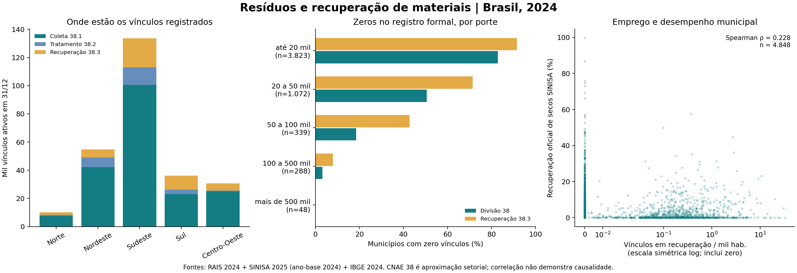
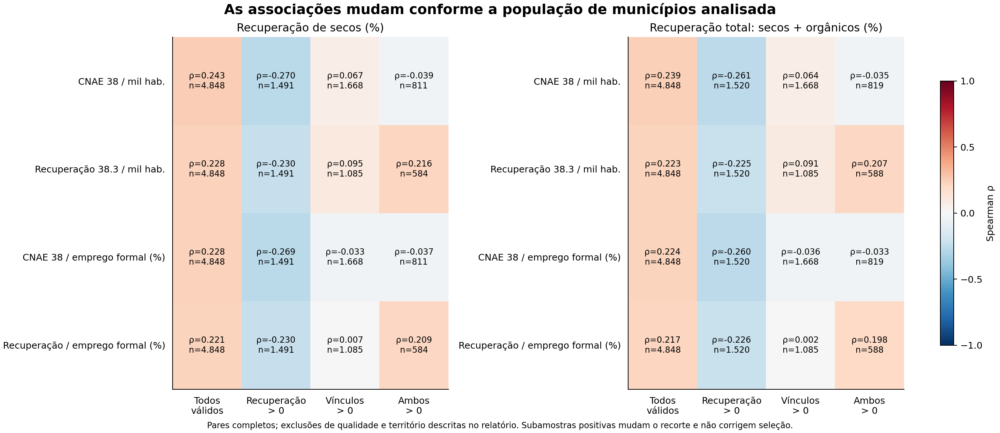
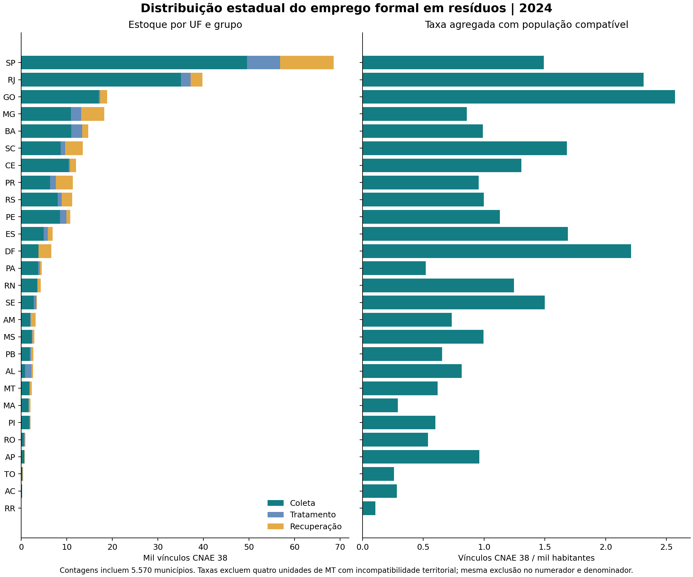

# Emprego formal em resíduos: análise exploratória de 2024

## O que os registros mostram

O universo municipal reúne 265.143 vínculos ativos na divisão CNAE 38: 198.344 em coleta, 23.856 em tratamento/disposição e 42.943 em recuperação de materiais. São vínculos no município do estabelecimento, não pessoas únicas nem novas vagas. O total Brasil do arquivo bruto é 265.151; oito vínculos sem município, todos em recuperação, ficam fora do dataset municipal.

Dos 5.570 municípios, 3782 (67,9%) têm zero vínculo formal registrado em CNAE 38, e 4437 (79,7%) têm zero em recuperação de materiais. Isso não demonstra ausência de atividade: trabalho informal, cooperativas sem vínculos formais e serviços classificados em outros CNAEs podem ficar fora do recorte.

Após excluir quatro municípios de MT com delimitação territorial incompatível entre numerador e população, a taxa agregada é 1,248 vínculo CNAE 38 por mil habitantes; para recuperação, 0,202. A participação agregada no estoque de todos os setores é 0,464% para CNAE 38 e 0,075% para recuperação. Taxas agregadas são razão entre somas; medianas municipais são medidas distintas, não ponderadas.

## Relação com a recuperação informada ao SINISA

A amostra de associações tem **4848 municípios**: resposta SINISA, verificações iniciais de qualidade aprovadas e território compatível. Os 716 não respondentes não foram transformados em zero; dois municípios com alerta de qualidade e as quatro unidades de MT ficam fora das associações. A mesma amostra básica é usada para shares, para manter a comparação entre indicadores.

Para vínculos em recuperação por mil habitantes versus recuperação oficial de resíduos secos, Spearman é **0,228 (n=4848)**. Na subamostra com ambos positivos, passa a **0,216 (n=584)**. A mudança ilustra a influência dos zeros e da seleção do recorte; não indica que uma amostra seja automaticamente superior à outra.

| Medida de emprego vs recuperação de secos | Todos válidos | Recuperação > 0 | Vínculos > 0 | Ambos > 0 |
|---|---:|---:|---:|---:|
| CNAE 38 / mil hab. | 0,243 (n=4848) | -0,270 (n=1491) | 0,067 (n=1668) | -0,039 (n=811) |
| Recuperação 38.3 / mil hab. | 0,228 (n=4848) | -0,230 (n=1491) | 0,095 (n=1085) | 0,216 (n=584) |
| CNAE 38 / emprego formal (%) | 0,228 (n=4848) | -0,269 (n=1491) | -0,033 (n=1668) | -0,037 (n=811) |
| Recuperação / emprego formal (%) | 0,221 (n=4848) | -0,230 (n=1491) | 0,007 (n=1085) | 0,209 (n=584) |

O CSV `associacoes_spearman_com_n.csv` contém também as associações com recuperação total (secos + orgânicos), contagens absolutas para comparação do efeito do porte e população. Cada linha informa n, quantos zeros permanecem e a correlação parcial por porte. A participação do grupo 38.3 no estoque formal tem correlação 0,221 com recuperação de secos (n=4848).

## Método e sensibilidade ao porte

Spearman foi calculado como correlação de Pearson entre postos médios, em pares completos. Para a correlação parcial, foram regredidos separadamente os postos de emprego e recuperação sobre os postos de log10 da população, com intercepto; correlacionaram-se os resíduos. Para a densidade de vínculos no grupo 38.3 e recuperação de secos, o coeficiente parcial é 0,198, com o mesmo n=4848. Como log é monotônico, seus postos são os mesmos da população. Esse ajuste é um controle exploratório de porte, não um modelo causal.

As subamostras positivas são definidas separadamente para cada indicador SINISA e medida de emprego. Para taxas e shares, emprego positivo equivale a estoque positivo, pois denominadores são positivos. As contagens e taxas não foram aparadas nem winsorizadas. Os gráficos mantêm os extremos; o diagrama usa escala simétrica log para acomodar zeros e assimetria. Não foram usados testes de significância para escolher conclusões.

## Desagregações e implicações para diagnóstico

As tabelas por UF, região e porte apresentam estoques por grupo, estabelecimentos, frequência de zeros, shares, taxas agregadas, medianas municipais e n da amostra SINISA. Contagens incluem todas as 5.570 unidades; nas taxas, numerador e denominador excluem conjuntamente as quatro unidades de MT. Não se deve comparar uma soma nacional a uma mediana municipal como se fossem a mesma medida.

Os registros permitem localizar concentração de emprego formal e municípios onde o setor registrado é pequeno. Eles não identificam, sozinhos, um déficit de empregos verdes nem o número de vagas que determinada intervenção geraria. Municípios com recuperação SINISA positiva e poucos vínculos CNAE 38 são candidatos a investigação sobre cooperativas, informalidade, prestadores regionais e classificação econômica. Municípios com emprego setorial elevado e baixa recuperação também precisam de diagnóstico do tipo de resíduo, área atendida e composição dos serviços.

Prescrições devem combinar esses sinais com custos, cobertura, infraestrutura e inclusão de catadores. Capacitação e formalização podem ser discutidas como medidas a avaliar, com custos e condições de trabalho. Automatização pode substituir tarefas e exigir novas competências; estes dados transversais não quantificam esse efeito.

## Limites que permanecem

- A CNAE é atividade principal do estabelecimento, não ocupação individual. Divisão 38 inclui resíduos urbanos, industriais e perigosos, e o grupo 38.3 é recuperação de materiais; nenhum equivale automaticamente a emprego verde e decente.
- Informais não entram na RAIS. Um trabalhador pode possuir mais de um vínculo. Postos em prefeituras classificadas como administração pública podem ficar fora da divisão 38.
- Estabelecimento, residência do trabalhador e área atendida por prestadores regionais são geografias diferentes. SINISA descreve o serviço municipal, enquanto RAIS descreve a localização e atividade do estabelecimento.
- Não resposta, zeros, concentração regional, diferenças econômicas e de capacidade institucional podem alterar as associações. Taxas, shares e controle de porte não eliminam esses fatores.
- A análise é transversal, de 2024. Não demonstra causalidade, impacto de políticas, redução futura de custos ou geração futura de vagas.

## Arquivos e reprodução

Executar `scripts/analisar_emprego_setorial.py` após o ETL. O script gera os CSVs, o JSON `analises/emprego_setorial/resumo_diagnostico_setorial.json` e os PNGs nessa mesma pasta; a impressão digital do dataset de entrada fica no JSON. As fontes, layouts e reconciliações originais estão documentados em `docs/RAIS_SETORIAL.md` e nas evidências RAIS.

